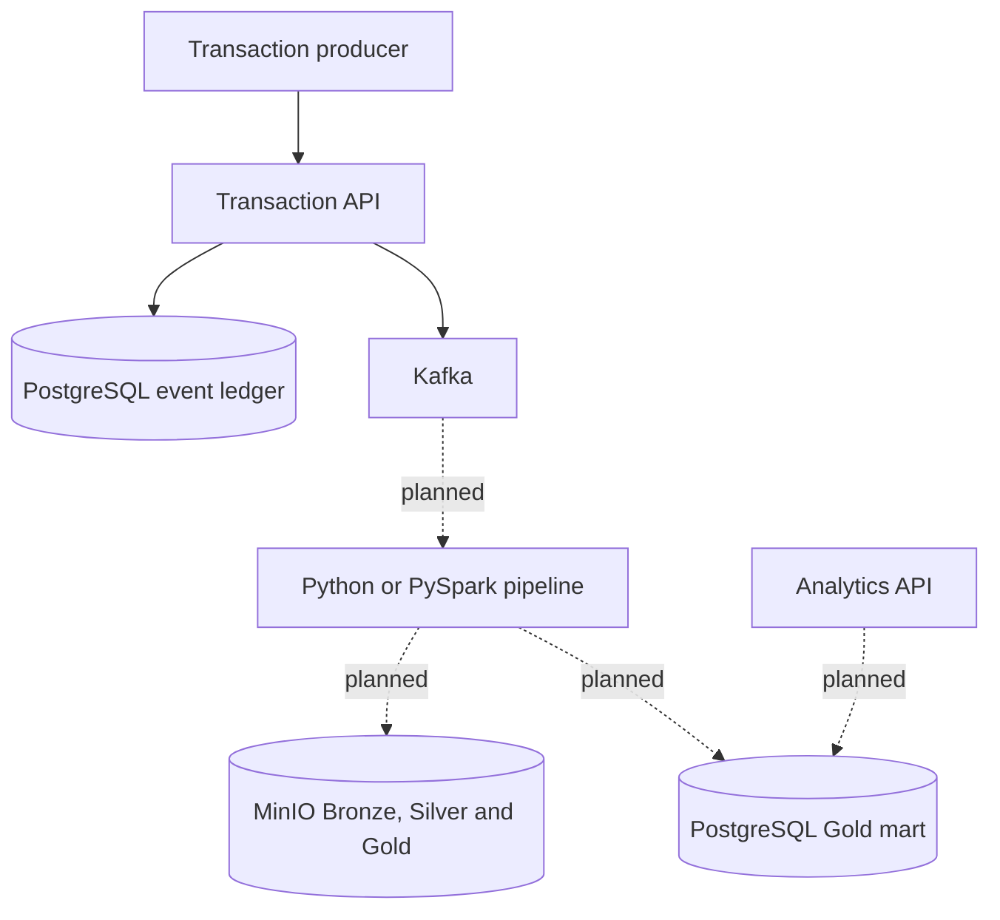

# Architecture and data contracts



## Event contract

Clients POST a JSON object to `/api/v1/transactions`. The Kafka message adds `schemaVersion: 1` and the database-recorded `ingestedAt` timestamp to the normalized event. Both timestamps serialize as UTC ISO-8601 strings. Unknown request fields are rejected and never logged.

| Field | Contract |
|---|---|
| eventId | UUID and idempotency key |
| transactionId | Shared business ID with 1–64 letters, digits, underscores or hyphens |
| eventType | AUTHORIZATION, REVERSAL or ADJUSTMENT |
| cardToken | Synthetic token beginning with `tok_`, followed by 1–60 letters, digits, underscores or hyphens |
| merchantId and merchantCategory | Required nonblank dimensions, up to 64 characters each |
| amount | Positive JSON decimal with up to 16 integer digits and two fractional digits, normalized to scale 2 |
| currency | Three uppercase letters and a recognized ISO 4217 code |
| eventTime | ISO-8601 timestamp with a UTC offset and up to microsecond precision, in the supported UTC year range 0001–9999 |
| status | APPROVED, DECLINED or REVERSED |
| sourceSystem | Nonblank producer label up to 64 characters |

Intake accepts late events and stores `eventTime` independently of `ingestedAt`. Lifecycle reconciliation and transition rules belong to curation. Money uses a fixed two-decimal scale for this synthetic dataset. Each event retains its original currency.

## API outcomes

| HTTP status | Condition |
|---|---|
| 201 | New event recorded and Kafka publication confirmed. Location points to its transaction history. |
| 200 | Exact replay already published, successful retry of a pending event, or lookup with matching events. |
| 400 | Malformed request, invalid fields, or invalid lookup ID. |
| 404 | Lookup ID has no recorded events. |
| 409 | An event ID already belongs to a different normalized payload. |
| 503 | Storage operation failed or Kafka publication could not be confirmed. Retry an intake with the original ID and payload. |

Errors include `code`, `message`, and an `errors` array. An invalid request can return the following response.

```json
{
  "code": "INVALID_EVENT",
  "message": "Check the event fields.",
  "errors": [{"field": "currency", "message": "must be a recognized ISO 4217 code"}]
}
```

## Persistence, publication, and recovery

The ledger has one row per event ID. A PostgreSQL primary key and `INSERT ... ON CONFLICT DO NOTHING` protect against concurrent inserts. The service commits the original event before attempting Kafka publication. A second, bounded database transaction locks that event row while checking payload equality, sending to Kafka, and recording successful publication. Published replays return the existing receipt. Pending replays attempt publication again. The API exposes the pending state on lookup.

A lost Kafka acknowledgement or a database failure after acknowledgement can leave a Kafka record with a pending ledger row. Retrying may deliver a duplicate, so the downstream consumer must deduplicate by event ID. Clients retry pending events by resubmitting the original ID and payload. Operators can identify pending events by `published_at IS NULL`. Holding the row lock during a broker call limits concurrent retries for the same ID. A production dispatcher or transactional outbox can remove broker latency from request threads and recover pending events independently of clients.

Kafka uses the versioned topic `commercial-card.transactions.v1`, three partitions, and the synthetic card token as the key. Events for a card share a partition while the partition count and key mapping remain stable. Partition offsets show broker append order, which can differ from event time and from request arrival order when requests are concurrent or retried. The planned curation consumer group is `transaction-curation-v1`. It should commit offsets only after durable writes and support at-least-once delivery.

## Planned curation and metric definitions

Bronze will retain one row per Kafka topic, partition, and offset, with raw payload, source, ingestion timestamp and processing status. Records that cannot be decoded will go to quarantine with a reason. Silver will normalize types, deduplicate by event ID and preserve rule failures. The initial lateness proposal is to accept events within 24 hours of the greatest business event time observed in the replayable input and quarantine older events. Calculate the policy from event time so the checked-in fixture can replay on any date.

Gold will keep one fact per transaction ID, attributed to the authorization's UTC date, merchant category and currency. The candidate daily metric counts approved authorizations, including fully reversed ones, and reports their net spend after reversals and adjustments. A reversal subtracts its amount and an approved adjustment adds its amount. Declines contribute to the approval/decline rate denominator and to the decline count. They add no spend or approved transaction count. Group by currency without conversion. On the fixture, FUEL/USD has two approved transactions and 30.00 net spend. MAINTENANCE/USD has one declined authorization, zero approved transactions, and zero spend.

Partition curated Parquet/Snappy outputs by the business date and provide CSV for inspection. Parquet supplies typed columns and allows selective reads. Snappy favors inexpensive compression and decompression. CSV is easy to inspect but requires an explicit schema and usually reads more data. The proposed daily-spend API will query an independently rebuilt Gold mart over a validated date range.

## Production considerations

Use restricted broker and database access, authenticated APIs, secret management, TLS, and payload-free logs. Track pending rows, publish latency, consumer lag and quarantine rates. Review retention rules for the ledger, topic, and lake, and define a compatible schema-evolution policy before adding producers. Size Kafka partitions deliberately and plan migrations that preserve consumer correctness during rollout.
